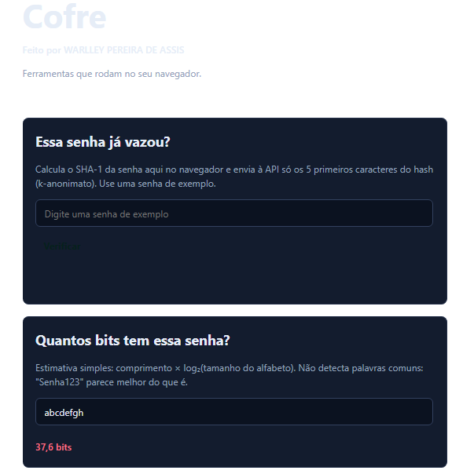

# Cofre

Kit de segurança digital que roda no navegador.
assis

# Cofre: kit de segurança digital

**Veja funcionando: **https://github.com/mrassistec000-art/cofre
## O que é
Warlley Pereira de Assis
Escreva aqui, com suas palavras, em 2 ou 3 frases.

## Ferramentas

- **Essa senha já vazou?** Consulta uma base real de senhas vazadas sem enviar a senha (k-anonimato).
- **Quantos bits tem essa senha?** Estima a força da senha.
- **NOME DA SUA FERRAMENTA:** o que ela faz.

## O que eu aprendi

- Escreva pelo menos 3 itens reais.

## Tecnologias

HTML, CSS, JavaScript, Git, GitHub Pages e a API Pwned Passwords.

## Sobre o histórico

O histórico tem um arquivo `.env` com uma senha falsa, de propósito: foi um exercício para mostrar que apagar um arquivo não apaga o que já foi publicado no Git.

## Créditos

Código-base do Prof. Mario Rebello, na disciplina Introdução à Ciência da Computação (2026/2).
A ferramenta NOME DA SUA FERRAMENTA é de minha autoria. Licença MIT.
